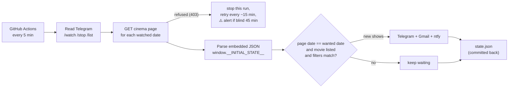

# showtime-watcher

Get an alert on your phone and by email the moment **BookMyShow opens bookings** for a
movie at your cinema. It runs free on GitHub Actions every 5 minutes, and you manage it
from Telegram.

```
🚨 Bookings OPEN: Jailer 2 @ ALLU Cinemas: Kokapet
📅 Fri 30 Oct
  Telugu · DOLBY CINEMA 2D
   • 07:55 PM · SCREEN 1 · ₹295–350
   • 11:20 PM · SCREEN 1 · ₹295–350
[Fri 30 Oct · 07:55 PM · SCREEN 1]  ← opens seat selection directly
```

## How it works



Two facts about BookMyShow drive the design (checked on the live site in Oct 2026):

| Fact | Consequence |
|---|---|
| Each cinema page embeds all its data as JSON (`window.__INITIAL_STATE__`): bookable dates, movies, language, format, screen, times, prices. | No HTML scraping and no browser: a 1-second HTTP request is enough. |
| A date that isn't on sale **redirects to today's page** with HTTP 200. | "Movie is on the page" is not proof. v2 only counts a date as open when the page's own date equals the date you asked for (v1 got false alerts here). |
| BookMyShow's bot protection **sometimes refuses GitHub's servers** (HTTP 403; seen on 18 Oct 2026). | A refused check is reported, not worked around (no proxies, stealth browsers or challenge solving). The watcher backs off, alerts you if it's blind for 45 min, and logs how often it gets through (`/status`, daily check-in). |

## One-time setup

### 1. Secrets (repo → Settings → Secrets and variables → Actions → *New repository secret*)

| Secret | What it is | Where to get it |
|---|---|---|
| `TELEGRAM_TOKEN` | your bot's token | already set (from v1); else talk to @BotFather → `/newbot` |
| `TELEGRAM_CHAT_ID` | your chat with the bot | already set (from v1) |
| `GMAIL_ADDRESS` | Gmail that sends the alerts | your address |
| `GMAIL_APP_PASSWORD` | 16-character app password (not your login password) | Google Account → Security → 2-Step Verification on → **App passwords** |
| `NTFY_TOPIC` | a long random topic name, e.g. `bms-sai-7Kq2xW9pLm4R` | make one up; anyone who knows it can read it |
| `EMAIL_TO` *(optional)* | send email somewhere else | defaults to `GMAIL_ADDRESS` |

Channels without secrets are simply skipped.

### 2. ntfy loud alarm on your phone

1. Install **ntfy** (Play Store / App Store) and subscribe to your `NTFY_TOPIC` on `ntfy.sh`.
2. Android: in the app's notification settings, let **max priority** ring through *Do Not Disturb*.
   "Bookings OPEN" is sent at max priority (5); other alerts are quieter.

### 3. Check it

Actions → **Showtime Watcher** → *Run workflow*:
- `test-alert`: every channel should ping you within a minute.
- `probe`: prints what your cinema is selling (proves GitHub can read BookMyShow).

## Using it (Telegram)

| Command | Example | Meaning |
|---|---|---|
| `/watch` | `/watch Jailer 2 30 Oct` | that movie at your default cinema on 30 Oct |
| | `/watch Rising Sun` | **any** date: alert as soon as it's bookable at all |
| | `/watch Jailer 2 on fri format=dolby after=6pm` | filters: `lang=` `format=` `screen=` `after=` `before=` |
| | `/watch Kara 30 Oct, 31 Oct <cinema link>` | another cinema; the first link you use becomes the default |
| `/list` | | everything watched, with live status |
| `/stop` | `/stop 2` · `/stop all` | remove |
| `/default` | `/default <cinema link>` | change the default cinema |
| `/status` | | is the watcher healthy? |
| `/test` | | test alert on every channel |

The bot replies on its next run (≤ 5 min, often more, see limits). Dates: `30 Oct`, `30/10`,
`2026-10-30`, `on fri`, `on tomorrow`. Words like *sun*/*tomorrow* only count as dates
after "on", so *Rising Sun* stays a title.

**Cinema link:** open the cinema on in.bookmyshow.com and copy the address, e.g.
`https://in.bookmyshow.com/cinemas/hyderabad/allu-cinemas-kokapet/buytickets/ALUC/20261018`.

### What you'll receive

| Alert | When | Channels |
|---|---|---|
| 🚨 Bookings OPEN | first matching show appears | all (ntfy max priority) |
| ➕ new shows | more matching shows added later (off with `notify=first`) | all |
| ℹ️ on sale, not as filtered | movie opened but no show matches your filters (once) | all |
| ⚠️ can't read BookMyShow | every check failed for 45 min | all |
| ✅ back | checks recovered | all |
| 👀 daily check-in | once a day after 9 AM IST (silent) | Telegram |

## Run it on your own machine

```bash
brew install uv                      # or: curl -LsSf https://astral.sh/uv/install.sh | sh
uv sync                              # creates .venv with everything
cp .env.example .env                 # fill in the same secrets
uv run showtime-watcher probe        # what is my default cinema selling today?
uv run showtime-watcher probe --date "30 Oct"
uv run showtime-watcher add Jailer 2 30 Oct format=dolby
uv run showtime-watcher run --dry-run    # check without alerting or saving
uv run showtime-watcher run --loop 300   # watch from this machine, every 5 min
uv run pytest                        # 94 tests, uses a real captured page
```

## Files

| Path | Role |
|---|---|
| `src/showtime_watcher/bms.py` | fetch a cinema page over HTTP and parse its JSON |
| `src/showtime_watcher/checker.py` | is a target open? movie matching, filters, the redirect check |
| `src/showtime_watcher/watcher.py` | one pass: commands → checks → alerts → health → state |
| `src/showtime_watcher/bot.py` | Telegram commands |
| `src/showtime_watcher/notify.py` | Telegram, Gmail SMTP, ntfy |
| `src/showtime_watcher/targets.py` | `targets.yaml` and the `/watch` date/filter grammar |
| `src/showtime_watcher/state.py` | `state.json`: what was announced, health, reachability log |
| `.github/workflows/watcher.yml` | the 5-minute schedule, manual probe/test, state commit |
| `.github/workflows/ci.yml` | lint + tests on every code push (never touches BookMyShow) |

## Limits, honestly

- **GitHub's scheduler is best-effort.** "Every 5 min" usually means 5–15 min apart, and runs
  can be skipped when GitHub is busy. A hot show can still sell out first. Keep Telegram
  notifications on and ntfy allowed to ring.
- **Public repo:** Actions minutes are free. Your watch list and run logs are public; secrets
  stay hidden. GitHub disables schedules after 60 days without activity; the daily
  check-in commit to `state.json` prevents that.
- **BookMyShow can refuse GitHub's servers** (it did on 18 Oct 2026). Refused checks are
  not worked around. The watcher slows to one try every ~15 min, sends a ⚠️ alert if
  it's blind for 45 min (at most every 6 h), and `/status` plus the daily check-in show
  what share of the last 24 h it could actually see BookMyShow. If that share is low,
  GitHub alone isn't enough: run `uv run showtime-watcher run --loop 300` from a machine
  on your home internet instead.
- Be a good citizen: personal use, one page per watched date per run. Don't crank the
  schedule up. It's your account on both sites.
- AvailStatus (seat availability) codes aren't documented by BookMyShow, so alerts don't
  claim "fast filling" or "sold out".
